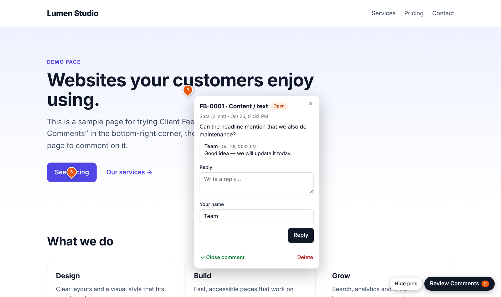
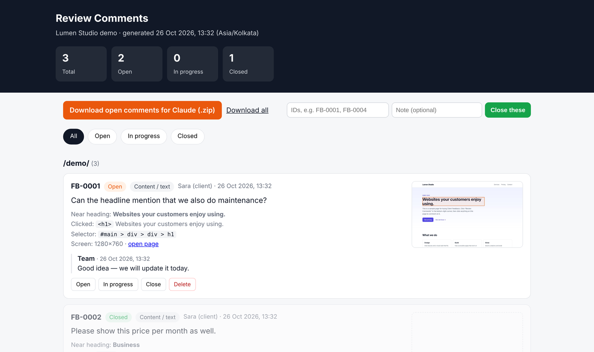

# Client Feedback

**Click-to-comment feedback for website reviews — built to be applied by Claude.**

Add one line to your HTML pages and your client gets a **Review Comments** button. They click
any part of the page, type a comment, and it is saved on your own server with the exact element,
a screenshot and the screen size. You download all open comments as one file, give it to
[Claude](https://claude.ai), and Claude finds the right markup and makes the changes.

No database, no account, no third-party service: a handful of PHP files and flat JSON storage.



## Features

- **Comment on anything** — the client clicks an element; the comment stores its CSS selector, HTML, text, nearest heading, screen size and an optional screenshot with the element outlined.
- **Pins on the page** — orange = open, blue = in progress, green ✓ = closed. Click a pin to open the thread.
- **Replies** — your team and the client can discuss each point in place.
- **Close and delete with passwords** — the client closes points with the *close* password; your team can also delete with the *team* password. Passwords stay on the server.
- **Private report** — filter, close, reopen, delete, and **download open comments for Claude** as a zip (readable HTML + JSON + screenshots).
- **Safe by default** — stored data is blocked from the web by `.htaccess`, spam honeypot, rate limits, wrong-password lockout, IDs never reused.
- **Works with caching hosts** — the page loads a tiny fixed loader that always fetches the latest widget, so updates appear even on hosts that cache JavaScript.



## Requirements

- Hosting with **PHP 7.4 or newer** (shared hosting such as SiteGround, cPanel, Hostinger, Apache or Nginx with PHP).
  Static-only hosts (GitHub Pages, Netlify, Vercel) cannot run the PHP part.
- Apache `.htaccess` support for the built-in protection of stored data. On Nginx, block
  `feedback/data/`, `feedback/config.php` and `feedback/lib.php` in your server config.
- Any modern browser for the client.

## Install (about 5 minutes)

1. **Download** this repository (green **Code** button → **Download ZIP**) or clone it.
2. **Copy the `feedback` folder** into your site, next to your `index.html`.
3. **Create your settings:** in `feedback/`, copy `config.example.php` to `config.php` and set:
   - `REPORT_KEY` — a long random string; it unlocks your private report
   - `CLOSE_PASSWORD` — give this to the client (close only)
   - `ADMIN_PASSWORD` — your team only (close and delete)
   - `PROJECT_NAME`
4. **Add the widget to every page** — run the tool from your site folder (Windows, Mac and Linux):
   ```bash
   python path/to/client-feedback/tools/add_feedback.py
   ```
   It adds `<script src="feedback/feedback.js" defer></script>` before `</body>` on every page,
   with `../` added for pages in sub-folders. Or add that line by hand.
   No Python? Use `tools/add-feedback.sh` (Mac/Linux) or `tools/add-feedback.ps1` (Windows PowerShell).
5. **Upload** the site, including `feedback/` and its hidden `.htaccess` files. Uploading a zip and
   extracting it on the server is the easiest way to keep the `.htaccess` files.
6. **Test:** open your site → **Review Comments** → click a heading → send a comment. Then open
   `https://your-site/feedback/report.php?key=YOUR-REPORT_KEY`.

Try it locally first: run `php -S localhost:8000` in this repository (after creating
`feedback/config.php`) and open <http://localhost:8000/demo/>.

## Using it

**Your client:** clicks **Review Comments**, clicks the part of the page they mean, types the
comment and their name, and presses **Send**. Clicking a pin shows the thread, where they can
reply or close the point with the close password.

**Your team:** opens the private report, downloads the open comments, and applies them with
Claude — see [docs/claude-workflow.md](docs/claude-workflow.md) for the ready-to-paste prompt
and the data format. Reply on the pins when changes are live so the client can check and close.

**Before go-live:** remove the widget and the folder:
```bash
python path/to/client-feedback/tools/add_feedback.py --remove
```
Download a final export from the report if you want a record, then delete the `feedback` folder
from the server.

## Configuration

| Setting (`feedback/config.php`) | Default | Purpose |
|---|---|---|
| `REPORT_KEY` | — | Unlocks `report.php`. Required. |
| `CLOSE_PASSWORD` | — | Close comments from the page. Empty `''` switches closing off. |
| `ADMIN_PASSWORD` | — | Close **and delete** from the page. Empty `''` switches deleting off. |
| `PROJECT_NAME` | `My project` | Shown in the report. |
| `TIMEZONE` | `Asia/Kolkata` | Dates in the report. |
| `MAX_SCREENSHOT_BYTES` | 2 MB | Largest screenshot accepted. |
| `RATE_LIMIT_COUNT` / `RATE_LIMIT_WINDOW` | 40 / 600 s | Comments per visitor per window. |
| `$ALLOWED_HOSTS` | any | Only accept comments sent from these hosts. |

Options on the script tag:

| Attribute | Effect |
|---|---|
| `data-position="left"` | Put the button bottom-left instead of bottom-right |
| `data-screenshots="off"` | Never take screenshots |
| `data-endpoint="…/save.php"` | Use a different save endpoint |

## Troubleshooting

| Problem | Fix |
|---|---|
| “Could not save” / “not set up on the server” | The `feedback` folder is missing or in the wrong place, or `feedback/data` is not writable (set `755`). `feedback/save.php?action=list` should return `{"ok":true,…}`. |
| “Client Feedback is not configured yet” | Copy `config.example.php` to `config.php`. |
| An update does not show | Your host or browser cached an old file. Flush the host cache (SiteGround: Site Tools → Speed → Caching → Flush) and press Ctrl+F5. |
| Pins missing | The commented element was removed or is hidden in the current view; the comment is still in the report. |
| Scripts can't read the report (SiteGround) | SiteGround's anti-bot check blocks non-browser requests. Download the zip from the report page in a browser. |
| “Wrong password” | Check `config.php`. The close password cannot delete. After 10 wrong tries a visitor waits 15 minutes. |

## Security notes

- The client never needs the report key or the team password; keep both private.
- `config.php` and `feedback/data/` are excluded from Git by `.gitignore`.
- Anyone who can open the site can leave comments and see the pins. Use it on review/staging
  sites, ideally with `noindex`, and remove it before go-live.

## Licence

[MIT](LICENSE) © 2026 Vijay Dabhi. Bundles [html2canvas](https://html2canvas.hertzen.com) (MIT) —
see [THIRD-PARTY-NOTICES.md](THIRD-PARTY-NOTICES.md).
